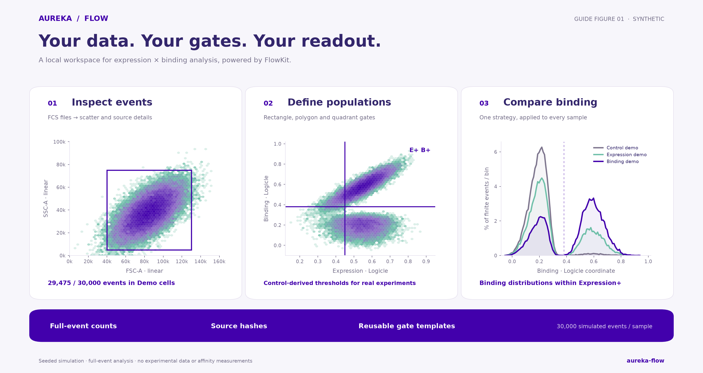
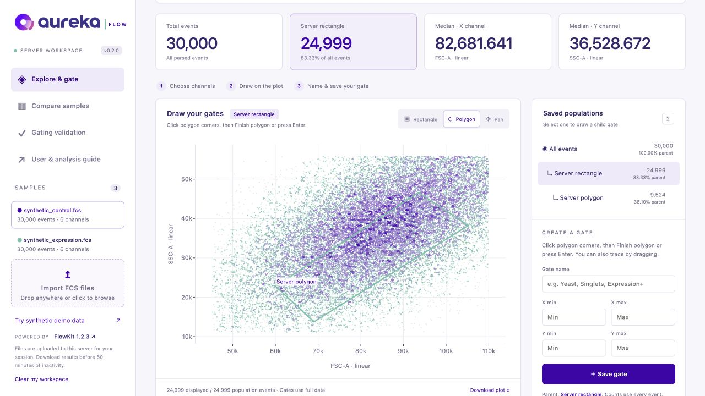
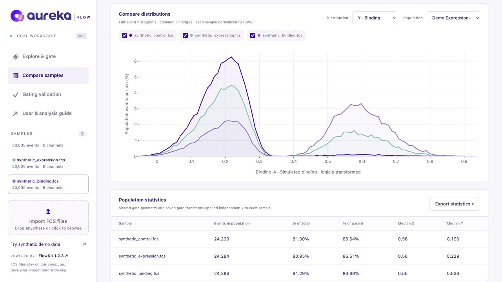

# Aureka Flow

[](https://github.com/Drjackxiaoyuchen/aureka-flow/actions/workflows/tests.yml)

[](https://github.com/whitews/FlowKit/releases/tag/1.2.3)

A browser flow-cytometry workspace for **FCS upload, manual gating, sample comparison and downloadable analysis**, built on [FlowKit](https://github.com/whitews/flowkit). Run it locally or host one server for visitors. The interface uses Aureka's purple and mint palette.

Upload FCS files, choose channels, drag rectangles or click polygon corners, then download your analyzed data. Every browser has its own workspace.

[](https://render.com/deploy?repo=https://github.com/Drjackxiaoyuchen/aureka-flow)

**Want a shared web app?** [Deploy the server](docs/DEPLOYMENT.md) or run `docker compose up --build -d` and open **http://localhost:8080**. Visitors use a browser and do not install Python. The Render button sets up hosting in your account; it is not a live app link.

[Features](#features) · [Quick start](#quick-start) · [Documentation](#documentation) · [Code examples](examples/README.md) · [Validation](#compare-with-a-human-flowjo-workspace) · [Contributing](CONTRIBUTING.md)



**New to the app? Start with the [documentation and six-part learning path](docs/README.md).** The [complete tutorial](docs/TUTORIAL.md) includes a ten-minute demo, illustrated gates, exact reference counts, guidance for real yeast-display experiments and troubleshooting. The same guide opens locally from **User & analysis guide** in the app.

[Download the synthetic gate project](docs/tutorial-project.json) · [Check the demo results](docs/DEMO_RESULTS.md) · [Browse the editable figures](aureka_flow/static/assets/)

## Features

| Task | Available in Aureka Flow v0.2 |
| --- | --- |
| Inspect FCS | Whole-page drop/upload, sample switching, detector/stain labels, metadata and SHA-256 provenance. |
| Draw populations | Drag rectangles, click polygon vertices and finish explicitly, or trace freehand; save beside the plot and create nested populations. |
| Analyze expression × binding | Four threshold quadrants plus an overlapping Expression+ range population. |
| Choose coordinates | Linear, Logicle or GatingML Asinh axes; each gate retains its own settings. |
| Compensate | Apply a compatible embedded FCS spillover matrix. |
| Compare samples | Full-event counts, total/parent fractions, transformed medians and normalized histograms. |
| Save and reproduce | Gate-project JSON, GatingML, event/statistics CSVs and plot PNGs. |
| Download an analysis | One ZIP containing statistics, optional gated events, project, GatingML and a provenance manifest. |
| Share a server | Per-browser sessions, idle expiration, configurable budgets and Docker/Render deployment. |
| Check saved human gates | Optional FlowJo-workspace replay with count/frequency differences and source hashes. |

FlowKit **1.2.3** supplies the numerical gate engine. Aureka Flow provides the browser interface and focused workflow above. The wider toolkit has additional APIs and analyses; see the official [FlowKit documentation](https://flowkit.readthedocs.io/en/latest/) when working directly in Python.

## Quick start

Requires **Python 3.11 or 3.12**. Works with a local browser on macOS, Linux or Windows.

```sh
git clone https://github.com/Drjackxiaoyuchen/aureka-flow.git
cd aureka-flow
python3.11 -m venv .venv
source .venv/bin/activate
python -m pip install --upgrade pip
python -m pip install .
python -m aureka_flow
```

On Windows, use `py -3.11 -m venv .venv` and `.venv\Scripts\Activate.ps1` for the virtual environment. After installation, `aureka-flow` also starts the app.

The browser opens at **http://127.0.0.1:8765**. Keep the terminal open while using the app. Press Control-C to stop it. To choose another port:

```sh
python -m aureka_flow --port 8766 --no-browser
```

On macOS, you can instead double-click **Setup Aureka Flow.command**, followed by **Start Aureka Flow.command**. The setup script installs the tested dependency lock file.

## Use the workspace

1. Click **Upload FCS** or drop `.fcs` files anywhere in the window. You can upload from the analyzer or the validation page.
2. Choose the X/Y channels and display scales. For yeast-display work, gate the relevant cells and singlets first, then assign expression and binding channels according to your staining panel.
3. Choose **Rectangle** and drag across the plot, or choose **Polygon**, click its corners and click **Finish polygon** (or press Enter). Freehand dragging also works. Undo removes a corner; Escape cancels.
4. Name the population in the editor beside the plot and click **Save population**. It is selected automatically. Draw a child gate there, or select **All events** to start another top-level gate.
5. Use **Compare samples** to inspect distributions and population statistics across compatible samples.

The **Try synthetic demo data** button generates three deterministic samples in memory. They contain simulated scatter and fluorescence signals and are clearly labeled as synthetic. They are useful for trying the workflow and are not experimental measurements. No raw experiments or user data are bundled in the repository.



*Server workspace with a saved polygon. Click corners, finish, save, then download the analyzed population.*

## Documentation

| Resource | Purpose |
| --- | --- |
| [Server deployment](docs/DEPLOYMENT.md) | Run a shared upload → gate → download web app with isolated browser sessions. |
| [Documentation index](docs/README.md) | Choose a starting point and follow the six-part learning path. |
| [User and analysis guide](docs/TUTORIAL.md) | Learn upload, transforms, parent/child gates, controls, interpretation and exports. |
| [Worked code example](examples/README.md) | Run the same analysis in Python and generate an offline interactive figure and statistics. |
| [Synthetic reference results](docs/DEMO_RESULTS.md) | Check every saved population against exact demo counts. |
| [Human-workspace comparison](#compare-with-a-human-flowjo-workspace) | Replay an existing strategy on matching FCS files. |
| [Contributing](CONTRIBUTING.md) | Report a problem, run checks or update the guide. |



*Actual application screenshot. The samples and results shown are synthetic.*

The browser workflow and the Python example share the same saved tutorial gates. To run the example from an installed source checkout:

```sh
python examples/analyze_synthetic.py
```

Open the resulting `exports/synthetic-walkthrough/interactive-analysis.html` in a browser. It bundles Plotly locally and includes the sampled scatter alongside full-event comparison histograms. Statistics, source hashes and the project JSON are saved next to it. The script checks its results against the published reference.

## Analysis behavior

- Linear, Logicle and GatingML Asinh scales are available independently for X and Y. Default transform parameters are T=262144, M=4.5, W=0.5, A=0; Asinh uses T/M/A. These are display defaults, not instrument calibration.
- Each saved gate retains its compensation and transform settings. Changing the displayed channels or scales does not reinterpret existing gates.
- Rectangle lower boundaries are inclusive and upper boundaries are exclusive, following FlowKit/GatingML.
- The expression/binding tool creates four quadrants within the current parent plus an overlapping **Expression+** range population. Thresholds are entered in the current axis coordinates and should come from appropriate experimental controls. Do not sum all five populations.
- Scatter displays at most 25,000 finite coordinate pairs, sampled deterministically. Gate counts, percentages, medians and histograms use the full event data. Rare populations may be visually absent from the display sample while still being counted.
- Population medians use finite values in the selected display scale. Histogram comparisons use common bin edges and normalize each nonempty sample to 100% of finite values in the selected channel.
- Uncompensated data use FlowKit's `source='raw'`, which already includes standard FCS gain/log/time preprocessing. Original event order is preserved.
- Compensation can use an embedded FCS spillover matrix. Missing or incompatible matrices and detector names raise explicit errors. Custom matrix import is not implemented.

No automatic cell, singlet, viability or positive gates are inferred. Fluorescence, positive fractions and display/capture readouts are assay-specific; the app does not infer solution affinity, off-rate or cellular potency.

## Save and export

| Action | Result |
| --- | --- |
| Save project | JSON with gates, their transforms and compensation settings, software versions, source metadata and SHA-256 hashes. |
| Open project | Restore a strategy after reloading the source FCS files, or apply it as a template to compatible samples. |
| Export statistics | CSV with counts, percentages of total/parent, X/Y medians, transform settings, compensation, hashes and compatibility errors. |
| Export population events | Every gated event in all channels as uncompensated or compensated values. Includes source filename/hash and zero-based source-event index. Display transforms are not applied to these CSV values. |
| Export gates | GatingML 2.0 with XML-safe gate IDs and a comment mapping human names to those IDs. |
| Download plot | PNG of the displayed scatter, including sample, population, compensation and display count. |
| Download analysis · ZIP | Statistics, optional full gated event CSVs, project JSON, GatingML, source hashes and settings for the current population and selected sample(s). |

**Save project does not embed the FCS events.** Keep the source files and reload them when restoring a project. Save the project JSON alongside event/statistics exports to preserve the gate definitions.

One browser session owns one in-memory workspace; its tabs share that workspace. Other browsers receive separate sessions. Restarting the process or expiring an idle session clears its data. Default limits are 24 samples, 100 MiB per file, 300 MiB of FCS input and 100 gates; hosted limits are configurable. RAM usage is higher than file size.

The default launcher binds to loopback. [Server mode](docs/DEPLOYMENT.md) supports remote visitors and scopes samples, gates and exports to opaque browser-session cookies. Hosted files are processed on the server; local files are processed on your computer. No remote plotting CDN is required. Organizational sign-in and durable event storage are not included.

## Compare with a human FlowJo workspace

An optional command replays an existing FlowJo workspace on its matching FCS files. It independently reads the stored FlowJo counts from XML and compares them with fresh FlowKit results, retaining full gate paths.

```sh
python -m pip install '.[validation]'
python scripts/validate_workspace.py \
  --workspace /path/to/reference.wsp \
  --fcs-dir /path/to/fcs_files
```

Outputs are written to the ignored `validation/workspace-report/` directory and are available at `/validation/` in the app after restarting it. They include a local HTML report, comparison CSV, plot and source hashes. The report exposes differences rather than tuning the gates to match saved counts.

For a public example, obtain the `data/8_color_data_set` directory from the [upstream FlowKit repository](https://github.com/whitews/flowkit), then point the command at `8_color_ICS.wsp` and its `fcs_files/` directory. Upstream example data are not included in this repository.

Saved-gate replay is distinct from automatically choosing new gates. Count agreement alone does not establish event-level agreement; that requires an independent human event-membership reference. Cross-software equivalence should be checked for the intended assay and gate types.

## Development

```sh
python -m pip install -e '.[dev]'
python -m pytest tests -q
node tests/test_intake.mjs
node tests/test_gating.mjs
node --check aureka_flow/static/app.js
python examples/analyze_synthetic.py
```

Node.js 22 is used for the JavaScript checks; Node is not required to run the application. The numerical tests cover gate boundaries, nested percentages, transforms, compensation, full-event counting despite display sampling, polygon gates, expression/binding partitions and export round trips. Intake checks cover the file picker, whole-page drop handler, file validation and busy-state handling.

| Location | Purpose |
| --- | --- |
| `aureka_flow/engine.py` | Typed gate/project models, full-event analysis and source provenance. |
| `aureka_flow/server.py` | Local FastAPI endpoints. |
| `aureka_flow/demo.py` | Deterministic synthetic FCS data. |
| `aureka_flow/static/` | Buildless HTML/CSS/JavaScript interface and Aureka brand assets. |
| `scripts/validate_workspace.py` | Optional saved human-gate comparison. |
| `docs/README.md` | Documentation index and six-part learning path. |
| `docs/TUTORIAL.md` | Source for the user guide and yeast-display analysis walkthrough. |
| `examples/analyze_synthetic.py` | Runnable, verified analysis with an offline interactive figure. |
| `scripts/build_tutorial.py` | Rebuild the synthetic PNG/SVG figures, reference results, demo project and local guide with `pip install '.[docs]'`. |
| `tests/` | Numerical/API and upload-handler checks. |

Uploaded events, experimental workspaces, local reports, credentials and environments are excluded by `.gitignore`. Generated outputs are local files and are not sent to GitHub by the app.

## License and attribution

Aureka Flow code is distributed under the [BSD 3-Clause license](LICENSE). Aureka names and logos remain brand assets and are not covered by that software license.

FlowKit is Copyright © 2018 Scott White and is distributed under BSD 3-Clause. Its attribution and license are retained in [THIRD_PARTY_NOTICES.md](THIRD_PARTY_NOTICES.md). See the [FlowKit paper](https://doi.org/10.3389/fimmu.2021.768541). Upstream authors do not endorse this customization.
