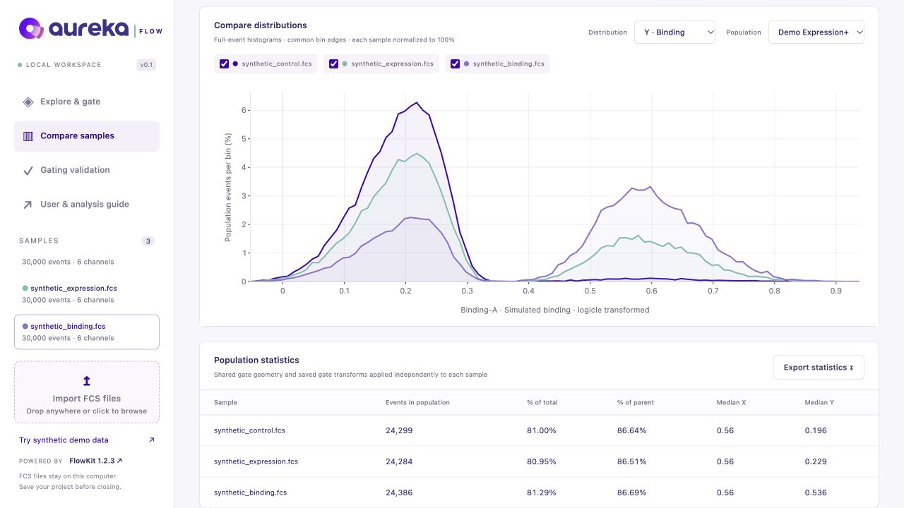

# Aureka Flow documentation

**Visual FCS analysis for expression × binding experiments.** Start with a ten-minute synthetic walkthrough, then learn to define populations, compare samples and preserve the analysis.

[Install & launch](../README.md#quick-start) · [Read the complete guide](TUTORIAL.md) · [Run a code example](../examples/README.md) · [Report an issue](https://github.com/Drjackxiaoyuchen/aureka-flow/issues/new/choose)

## Choose your starting point

| I want to… | Start here | Result |
| --- | --- | --- |
| Share a browser app with colleagues | [Server deployment](DEPLOYMENT.md) | One hosted server, separate browser workspaces, and downloadable analysis ZIPs. |
| Try the app without my own files | [Ten-minute demo](TUTORIAL.md#start-here) | Three synthetic samples and seven exact saved populations. |
| Analyze an experiment | [Experiment workflow](TUTORIAL.md#analyze-your-own-yeast-display-experiment) | A documented panel, controls, gate hierarchy and endpoint. |
| Reproduce a figure and its numbers in Python | [Executable example](../examples/README.md) | An offline interactive figure, statistics and a project JSON. |
| Compare with saved human gates | [FlowJo replay](TUTORIAL.md#compare-saved-human-gates-with-flowjo) | A report of count and parent-frequency differences. |
| Inspect a gate in its ancestor | [Backgating](TUTORIAL.md#backgate-a-population) | Selected events over the parent or all events on any channels. |
| Review FlowJo-inspired additions | [Feature review](FLOWJO_FEATURE_REVIEW.md) | Implemented features, official references and future candidates. |
| Fix an unexpected result | [Troubleshooting](TUTORIAL.md#troubleshooting) | Checks for channels, scales, compensation, counts and restore behavior. |

## Six-part learning path

Each lesson links to the relevant section of the full guide. The in-app **User & analysis guide** contains the same material and figures locally.

| Part | Learn | Practice |
| --- | --- | --- |
| **1 · Open and inspect** | [Workspace and source details](TUTORIAL.md#understand-the-workspace) | Upload FCS, identify detectors and check source hashes. |
| **2 · Scale and compensate** | [Expression/binding coordinates](TUTORIAL.md#3-assign-expression-and-binding-channels) and [real-data compensation](TUTORIAL.md#upload-inspect-and-choose-compensation) | Distinguish raw values from display coordinates; document correction. |
| **3 · Build a hierarchy** | [Rectangle and polygon gates](TUTORIAL.md#rebuild-the-demo-gates-by-hand) | Select a parent, draw a gate, save and inspect full-event counts. |
| **4 · Separate expression and binding** | [Quadrants and Expression+](TUTORIAL.md#4-create-quadrants-and-expression) | Use two thresholds and keep overlapping populations straight. |
| **5 · Compare and interpret** | [Distributions and medians](TUTORIAL.md#compare-distributions-and-medians) and [denominators](TUTORIAL.md#read-the-results-with-the-right-denominator) | Compare binding within expressers and report the reference population. |
| **6 · Save and reproduce** | [Projects and exports](TUTORIAL.md#save-a-reproducible-analysis) | Keep FCS, hashes, project JSON, statistics and assay metadata together. |

## See the actual interface

This is an application screenshot with synthetic data. The illustrated figures below use those same demo definitions and full-event reference results.

## Figure gallery

| Figure | What it explains | Download |
| --- | --- | --- |
| [Workflow overview](../aureka_flow/static/assets/tutorial-overview.png) | FCS → gates → sample comparison | [PNG](../aureka_flow/static/assets/tutorial-overview.png) · [Editable SVG](../aureka_flow/static/assets/tutorial-overview.svg) |
| [Gate hierarchy](../aureka_flow/static/assets/tutorial-gating.png) | Scatter, singlet band, quadrants and binding distributions | [PNG](../aureka_flow/static/assets/tutorial-gating.png) · [Editable SVG](../aureka_flow/static/assets/tutorial-gating.svg) |
| [Correct denominators](../aureka_flow/static/assets/tutorial-denominators.png) | Why % of singlets and % of expressers differ | [PNG](../aureka_flow/static/assets/tutorial-denominators.png) · [Editable SVG](../aureka_flow/static/assets/tutorial-denominators.svg) |
| [Modal overlay](../aureka_flow/static/assets/tutorial-overlay-modal.png) | Synthetic binding distributions among expressers with peaks scaled to 100% | [PNG exported by the app](../aureka_flow/static/assets/tutorial-overlay-modal.png) |

All public examples are explicitly **synthetic**. Get the [exact gate project](tutorial-project.json), [full results](DEMO_RESULTS.md) and [machine-readable reference](tutorial-metrics.json). Figure regeneration is described in the [guide](TUTORIAL.md#rebuild-the-public-figures).

## Aureka Flow and FlowKit

Aureka Flow supplies the browser workspace, manual drawing tools, expression/binding workflow, exports and user guide. **FlowKit 1.2.3 performs the saved gate analysis.** The browser's scatter sample does not determine membership or population statistics.

The browser app exposes a focused subset of the wider FlowKit toolkit. Its current features are listed in the [project overview](../README.md#features). For Python classes, additional gate types and other advanced analyses, see the official [FlowKit documentation](https://flowkit.readthedocs.io/en/latest/) and [source repository](https://github.com/whitews/flowkit). Upstream's latest documentation may describe newer APIs than our pinned version. Scientific attribution and licenses are retained in the [project notices](../THIRD_PARTY_NOTICES.md).

## Development and support

[Contributing](../CONTRIBUTING.md) · [Numerical and upload checks](../README.md#development) · [Issue tracker](https://github.com/Drjackxiaoyuchen/aureka-flow/issues)

When reporting an analysis discrepancy, include the software versions, gate path, coordinate settings and a synthetic/minimal reproducer where possible. Do not put private FCS events, workspace metadata or credentials into a public issue.
