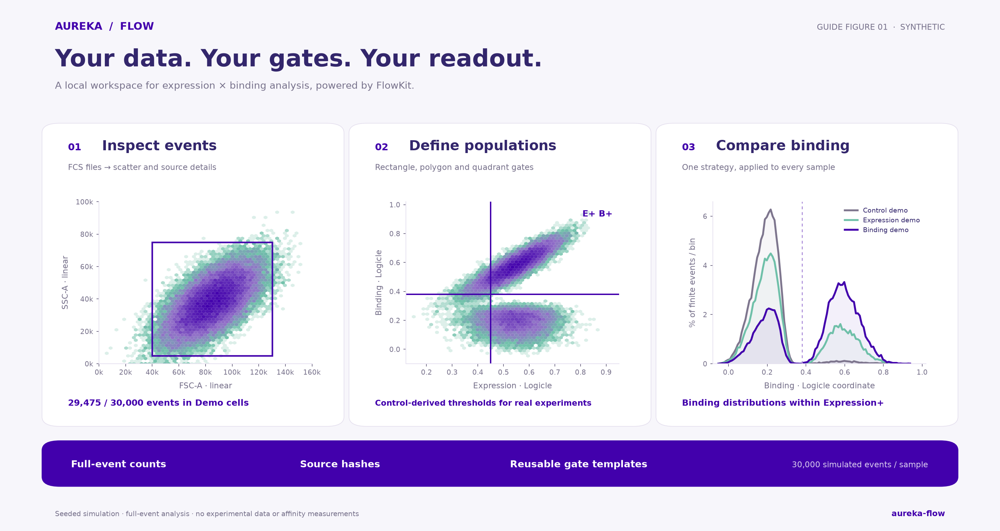
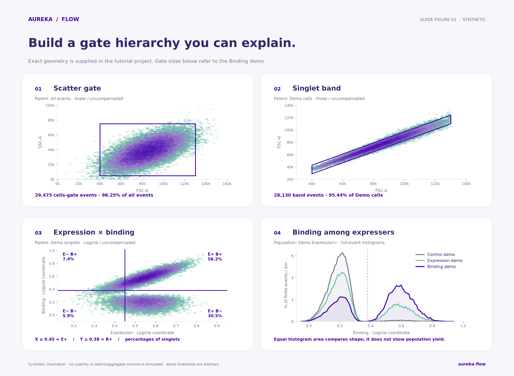
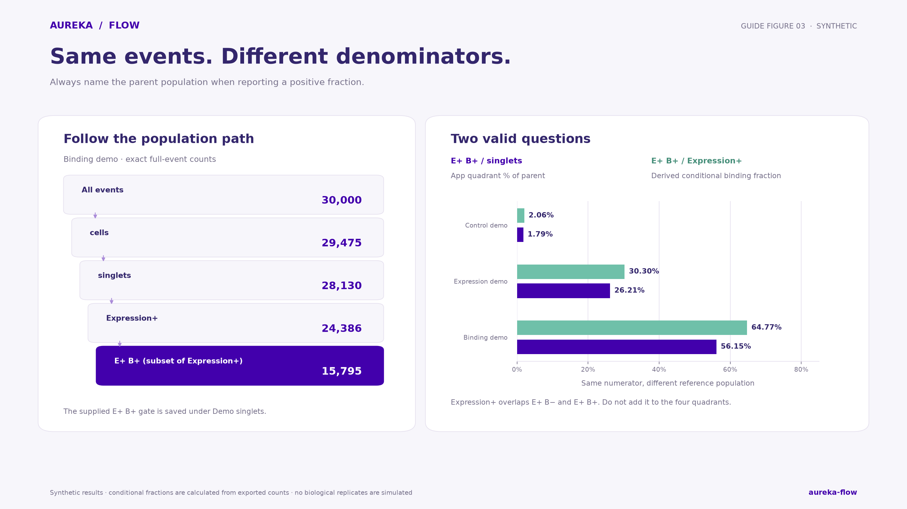

# Aureka Flow: from FCS to an interpretable result

Learn the interface with a reproducible demo, then use the same steps to analyze your own yeast-display expression and binding data. This guide covers manual gates, controls, comparisons, exports and the limits of the resulting measurements.



**All plots and reference numbers in this guide are synthetic.** They come from the app's seeded demo generator, not from an experiment. The figures are explanatory renderings of the full-event results, rather than screenshots of the interface. [Editable SVG](../aureka_flow/static/assets/tutorial-overview.svg).

## Start here

**First visit, about 10 minutes:** start the app, load the synthetic demo, open the supplied gate project and compare the three samples. **Learning to analyze, about 30 minutes:** work through manual gates and the interpretation sections below.

1. Follow the [installation instructions](../README.md#quick-start). Start with `python -m aureka_flow` or the macOS launcher. Open the local address printed in the terminal, normally `http://127.0.0.1:8765`.
2. Keep that terminal open. Analysis runs in memory in this process. Save any existing work before trying a different gate strategy.
3. Click **Try synthetic demo data**. Three samples appear, each with 30,000 events and six channels. Repeated clicks reuse identical data instead of adding duplicate files.
4. Download [tutorial-project.json](tutorial-project.json). On GitHub, use **Download raw file** to save the JSON; do not save the GitHub web page. In the app, click **Open project** and choose that JSON. Opening a project replaces the current gate strategy; save your previous project first if needed.
5. Select **synthetic_binding.fcs** in the sample list, then select **Demo singlets** under **Saved populations**. Change X to **Expression-A**, Y to **Binding-A**, and both scales to **Logicle**. Keep **Uncompensated** selected. Check the parameters described below.
6. Select **Demo Expression+**. Open **Compare samples**, choose **Demo Expression+** in its population menu, leave all three samples checked, and choose **Y · Binding** for the distribution. You should see a low-binding peak and progressively stronger positive components.

The same guide is available in the app through **User & analysis guide**. Its text, figures and demo gate download work locally; scientific references and GitHub links require internet access.

> A project contains gates and source references, not event data. Load the demo before opening this example project. For real projects, reload the original FCS files before restoring the JSON.

## Understand the workspace

| Area | What to do there |
| --- | --- |
| Sample list | Select a sample or remove it from memory. Removing a sample does not erase shared gates. |
| Upload FCS / drop area | Add one or more `.fcs` files. Dropping files anywhere in the app also works. |
| View source details | Inspect detector names, stain labels, FCS metadata, source hash and any embedded spillover matrix. |
| X / Y selectors | Choose which channels to display. Labels such as Expression and Binding describe intended roles; the user must assign the correct detectors. |
| Scale / Transform parameters | Set Linear, Logicle or GatingML Asinh separately for each axis. |
| Compensation | Choose uncompensated values or an embedded FCS spillover matrix. |
| Rectangle / Polygon / Pan | Drag a box, trace a freehand closed outline, or move around the plot. |
| Saved populations | Select the parent population before drawing a child gate. Counts and percentages update for the selected sample. |
| Expression × binding quadrants | Enter two thresholds to create four quadrants and an additional Expression+ population. |
| Compare samples | Apply the same strategy to compatible samples and inspect distributions, counts, percentages and medians. |

The plot displays at most **25,000 finite X/Y pairs**. Counts, medians and histograms use the **full event data**, so the number of visible points may be smaller than the population count. A rare gate can contain events that are absent from the displayed sample.

One process holds one shared workspace: tabs on the same port share samples and gates. For a separate practice workspace, start another process with `python -m aureka_flow --port 8766` and use its address.

## Rebuild the demo gates by hand

Use a fresh practice workspace for this section if you already loaded the example project. Gate names must be unique. A freehand polygon will rarely reproduce exactly the same vertices as the supplied project; use the project when checking exact reference counts.

The simulated samples have the same general scatter and expression distributions, with different binding-mixture proportions. Despite their filenames, **synthetic_control** is not a validated negative control, and **synthetic_expression** is not a single-stain compensation control. No debris, dead-cell or aggregate subpopulations are explicitly simulated. The following geometry is a software exercise, not a validated yeast-gating strategy.



[Editable SVG](../aureka_flow/static/assets/tutorial-gating.svg).

### 1. Draw a scatter gate

1. Load the demo and select **synthetic_binding.fcs**.
2. Select **All events**. Set X to **FSC-A**, Y to **SSC-A**, both scales to **Linear**, and compensation to **Uncompensated**.
3. Choose **Rectangle**. Press and drag across the plot, then release. A selection is only a draft until you save it.
4. In **Create a gate**, enter the exact bounds below, name it **Demo cells**, and click **Save gate**. You can also enter all four bounds without drawing first.

| Field | Value |
| --- | ---: |
| X min | 40000 |
| X max | 130000 |
| Y min | 5000 |
| Y max | 75000 |

The Binding demo should contain **29,475 events** in this gate, **98.25% of all events**. A lower rectangle boundary is included; an upper boundary is excluded. The name “cells” does not itself verify cell identity.

### 2. Draw a singlet band

1. Select **Demo cells** in Saved populations. Confirm the gate builder says **Parent: Demo cells**.
2. Set X to **FSC-A**, Y to **FSC-H**, both **Linear**, with **Uncompensated** data.
3. Choose **Polygon**. Hold the mouse button and trace around the diagonal band; release to finish the outline. This is a freehand lasso, not a click-to-add-vertices tool.
4. Name the gate **Demo singlets** and click **Save gate**. **Clear drawing** discards an unfinished selection. **Pan** changes navigation rather than drawing a gate.

The supplied project uses these exact `(FSC-A, FSC-H)` vertices, in order:

```text
(40000, 29000)
(130000, 110000)
(130000, 124000)
(40000, 43000)
```

That exact band contains **28,130 events** in the Binding demo. A hand-drawn band can legitimately give a different count; record the geometry you actually used. For real yeast, verify the appropriate singlet gate against the available pulse measurements and your assay controls. A synthetic diagonal band cannot establish how well aggregates are excluded in an experiment.

### 3. Assign expression and binding channels

1. Select **Demo singlets**.
2. Set X to **Expression-A** and Y to **Binding-A**. Set both to **Logicle**.
3. Expand **Transform parameters**. For both axes use **T=262144, M=4.5, W=0.5, A=0**, then click **Apply parameters**. Keep compensation **Uncompensated**: the demo has no spillover matrix.

These are transformed coordinates, not a logarithmic axis labeled in original fluorescence units. For example, in this transform a raw value of 500 maps to about 0.381019. Entering `500` as a Logicle threshold would therefore be a very different gate. See the [FlowKit Logicle definition](https://flowkit.readthedocs.io/en/latest/logicle_transform.html).

The defaults are convenient starting values, not instrument calibration. Each saved gate keeps its own channels, transform parameters and compensation mode. Changing the current view does not move or recalculate that gate's saved boundaries in a different coordinate system. Selecting a saved gate restores its own axis settings; after selecting a scatter/singlet parent, explicitly choose expression and binding again.

### 4. Create quadrants and Expression+

With **Demo singlets** selected and the expression/binding view configured:

1. Expand **Expression × binding quadrants**.
2. Enter **Gate prefix: Demo**.
3. Enter **Expression threshold · X: 0.45** and **Binding threshold · Y: 0.38**.
4. Click **Create 4 quadrants + E+**.

These thresholds are **arbitrary demo settings**, chosen to illustrate the interface. Use experimental controls to choose thresholds for real data.

| New population | Definition within Demo singlets |
| --- | --- |
| Demo E− B− | X < 0.45 and Y < 0.38 |
| Demo E+ B− | X ≥ 0.45 and Y < 0.38 |
| Demo E− B+ | X < 0.45 and Y ≥ 0.38 |
| Demo E+ B+ | X ≥ 0.45 and Y ≥ 0.38 |
| Demo Expression+ | X ≥ 0.45, regardless of binding |

Threshold equality belongs to the positive side. The four quadrants partition the finite demo parent. **Expression+ overlaps the two right-hand quadrants**. Adding all five counts would double-count expression-positive events. With nonfinite real values, do not assume every parent event belongs to a quadrant; inspect nonfinite-value reporting and exports.

The exact example project has **seven saved populations**: two preprocessing gates plus these five populations. In the Binding demo, E+ B+ contains **15,795 events** and Expression+ contains **24,386**.

## Read the results with the right denominator



[Editable SVG](../aureka_flow/static/assets/tutorial-denominators.svg).

For a population with count `N`, total source events `T`, and saved parent count `P`:

```text
% of total  = 100 × N / T
% of parent = 100 × N / P

Expression-positive fraction among singlets = 100 × N(Expression+) / N(singlets)
Binding-positive fraction among expressers  = 100 × N(E+ B+) / N(Expression+)
```

In this project all four quadrants are children of **Demo singlets**. Therefore the app's **% of parent** for E+ B+ uses **singlets**, not Expression+, as its denominator.

For the Binding demo:

```text
15,795 / 28,130 × 100 = 56.15% of singlets are E+ B+
15,795 / 24,386 × 100 = 64.77% of expression-positive events are binding-positive
```

The second number is a **derived conditional fraction**, calculated from two exported counts. The app does not automatically change a quadrant's parent or add that conditional statistic to its table. You can export E+ B+ and Expression+ statistics separately and calculate the ratio in a spreadsheet or script, matching rows by source hash/sample.

These should be your approximate reference results when using the exact supplied project:

| Sample | Singlets | Expression+ | E+ B+ | E+ B+ / singlets | E+ B+ / Expression+ | Median binding within E+ · Logicle |
| --- | ---: | ---: | ---: | ---: | ---: | ---: |
| synthetic_control.fcs | 28,046 | 24,299 | 501 | 1.79% | 2.06% | 0.196409 |
| synthetic_expression.fcs | 28,072 | 24,284 | 7,357 | 26.21% | 30.30% | 0.229261 |
| synthetic_binding.fcs | 28,130 | 24,386 | 15,795 | 56.15% | 64.77% | 0.535825 |

Counts are exact for the supplied seeded samples and geometry; displayed percentages and medians are rounded. [All population results](DEMO_RESULTS.md) · [Machine-readable results and hashes](tutorial-metrics.json).

The different positive components are programmed into a simulation. They are not evidence of an improved clone, enrichment, a binding constant or reproducibility across biological replicates.

## Compare distributions and medians

1. In Explore & gate, choose X = Expression-A, Y = Binding-A, both Logicle with the reference parameters, and Uncompensated.
2. Open **Compare samples**. Check the samples you want to include.
3. Choose **Demo Expression+** in the comparison population selector and **Y · Binding** for Distribution. This compares binding among expression-positive events.
4. Inspect the curves and table together. Then switch Distribution to **X · Expression** to see whether the selected populations have similar expression distributions.
5. Switch the comparison population to **Demo E+ B+** to inspect the positive subpopulation's count and percentage. Switch back to Expression+ for an uncensored view of binding across all expressers.
6. Click **Export statistics** for the current population and selected samples. Repeat for other populations needed in your report.

Histograms use **100 common bins** spanning the selected samples' finite values in the chosen channel. Each nonempty sample integrates to **100%**. A narrow peak can be taller because of its shape; its height does not establish a higher event count. Changing the selected sample set may change the common bin edges, so compare curves within the same view or retain the underlying statistics.

Medians use **all finite events in the selected population, in the current display transform**. A Logicle median such as 0.535825 is a transformed coordinate. It is not calibrated molecular abundance, and a ratio of two Logicle medians is not a fold change in fluorescence. Compare like-for-like channels, scales, parameters, compensation and populations. Finite values are evaluated per channel; the median's eligible events can differ from the finite X/Y pairs displayed in the scatter.

If a population is empty, its median is absent. The app currently reports 0% for an empty parent; interpret this as **no eligible parent events**, not as a measured negative biological response. The exported count is essential context.

## Analyze your own yeast-display experiment

### Record the experiment before gating

Keep an external sample sheet. The current app does not manage sequence/construct metadata, concentration series or replicate models for you. A useful record includes:

| Field | Why it matters |
| --- | --- |
| Source filename and SHA-256 | Identify the exact events used. A renamed copy may still have the same hash. |
| Construct / sequence ID, library and selection round | Retain the connection between phenotype and sequence. |
| Biological replicate and technical replicate | Distinguish repeated preparations from repeated measurements of the same preparation. |
| Target identity, format, concentration and label | Define what the binding signal measures. |
| Induction, stain/incubation conditions and timing | Support comparisons made under the same assay conditions. |
| Detector → stain → biological role | Identify expression, binding and any viability channels correctly. |
| Instrument settings, acquisition date and batch | Track changes that can shift fluorescence distributions. |
| Controls and compensation / upstream preprocessing | Document where thresholds and fluorescence correction came from. |
| Gate project, exclusions and endpoint definition | Preserve the exact analysis and denominator. |

### Choose controls for the question

Use your laboratory's validated panel and assay design. Typical roles are:

- **Unstained / uninduced / display-negative material:** establish relevant baseline fluorescence and expression background.
- **Binding-negative controls:** assess target-independent or reagent background using an appropriate nonbinder, omitted target, or detection-reagent control for the assay format.
- **A known reference binder:** monitor expected staining behavior under matched conditions.
- **Matched single-stain controls:** estimate spillover where compensation is needed. An FMO control evaluates the effect of the other stains on a positivity threshold; it does not replace a single-stain compensation control or prove specificity.

Control design for yeast-display binding is described in the [yeast-display affinity-maturation protocol](https://pmc.ncbi.nlm.nih.gov/articles/PMC5076467/). Broader compensation and control principles are covered by the [flow-cytometry guidelines](https://pmc.ncbi.nlm.nih.gov/articles/PMC7350392/). Adapt them to your assay rather than treating this software demo as an experimental protocol.

### Upload, inspect and choose compensation

Drop your `.fcs` files into the app or click **Upload FCS**. Current limits are **24 samples**, **100 MB per file** and **300 MB of FCS input**; actual RAM use is higher. Failed files are listed separately while successful files remain loaded. Identical file contents are deduplicated.

Open **View source details**. Check the detector names and staining map before assigning expression and binding. A detector name alone, such as an Alexa- or FITC-associated channel, cannot identify its biological role without the experiment's staining record.

Choose **Embedded FCS spillover** only when the embedded matrix is appropriate for these data and the channel values still require that correction. Missing or incompatible matrices produce an error. Do not apply compensation again to values already corrected upstream. Custom matrix import and spectral unmixing are not provided; resolve those upstream and document the export. “Uncompensated” in the app means FlowKit's raw source, which includes standard FCS gain/log/time preprocessing; it is not a byte-for-byte dump of the original FCS data segment.

### Build a justified hierarchy

A practical starting path is **all events → relevant yeast/scatter population → singlets → viable events, if measured → expression/binding populations**. Adapt its order and boundaries to your panel, controls and acquisition. Selecting a parent changes which events can enter its descendants.

Inspect acquisition stability if a Time channel is available, for example Time versus scatter. Exclude unstable intervals only with a documented rationale. The app does not automatically detect acquisition artifacts, yeast, singlets or dead cells. Without a validated viability measurement, do not label a gate as live cells merely because its scatter looks plausible.

Set expression and binding thresholds using the relevant controls in the **same compensation and transform coordinates** as the experiment. Decide and record how much negative-control signal your positivity rule permits. Check the resulting gates across all controls and samples before interpreting differences. Do not move a gate separately for each desired result.

The current workspace applies **one shared gate strategy** to all compatible samples. Matching detector names and a successful calculation do not demonstrate biological comparability. If instrument settings, panel or biological populations differ, analyze them as separate documented strategies/sessions and justify any harmonization.

### Choose an endpoint that answers the question

| Question | Useful descriptive endpoint | Interpretation boundary |
| --- | --- | --- |
| How much of the eligible population expresses the construct? | Expression+ count and % of the chosen singlet/viable parent | Depends on induction, tag staining and the expression gate. |
| How much target-associated signal occurs among expressers? | Binding distribution / median within Expression+; E+ B+ divided by Expression+ | Compare under matched target concentration and staining conditions. |
| Is higher binding simply accompanied by higher display? | Expression distributions and binding at a matched expression range | An Expression+ threshold alone does not equalize display levels. |
| Did a pool change after selection? | Matched pre/post distributions and positive fractions | Report the denominator, recovered counts and selection context; a fraction change is not a sequence-level enrichment measurement. |
| Which clone has stronger affinity? | A designed concentration titration with an appropriate binding model and controls | This app currently visualizes/gates events and exports statistics; it does not fit affinity or kinetics. |

If you need expression matching, draw and document the same narrow expression-range gate for compatible samples, inspect coverage and compare binding within that gate. This loses events and may exclude meaningful expression differences. The app does not calculate per-event binding/expression ratios or automatically normalize for display; do not divide transformed medians and call the result affinity.

A single target concentration, double-positive fraction or fluorescence shift supports a **binding-signal comparison in that assay**. Determining an apparent cell-surface binding constant requires a suitable titration and attention to equilibrium and ligand depletion, as discussed in [Hunter & Cochran's cell-binding assay protocol](https://pubmed.ncbi.nlm.nih.gov/27586327/). It does not by itself establish solution KD, kon/koff, cellular potency or an in-vivo effect.

### Check uncertainty and report honestly

Inspect each sample, its controls and its eligible count. Look for background changes, populations near a threshold, values piled up at a detector limit, and large losses at preprocessing gates. Record exclusions and potential saturation/censoring instead of silently converting them into exact quantitative values.

Use independent biological replicates for biological inference. Thousands of cells from one preparation do not create thousands of biological replicates. This app provides descriptive event-level summaries, without replicate-aware hypothesis tests, error bars or confidence intervals.

A useful result sentence is: **“At [target concentration and conditions], [n] of [N] expression-positive [singlet/viable] events were binding-positive using [control-derived rule]; the binding median in [specified population] was [value, scale]. Results came from [number and type of replicates].”** Add source hashes, gate-project version and any exclusions. Keep event counts, replicate counts and the endpoint's units explicit.

## Save a reproducible analysis

Save after choosing the gates and again after any deliberate change. Keep these together in your own analysis folder:

1. **Original FCS files** and a sample sheet containing sequence/construct, assay and replicate mapping.
2. **Save project JSON** with gates, hierarchy, transforms, compensation settings, software versions and source metadata/hashes.
3. **Statistics CSVs** for each reported population, including parent and total fractions. The export contains the current view's medians and compatibility errors.
4. **Population-event CSVs** when downstream analysis needs individual events. These contain all gated channels as uncompensated or compensated values, with source filename/hash and **zero-based original event index**. Display transforms are not applied to their channel values.
5. **GatingML** and plot PNGs as needed. GatingML uses XML-safe IDs with a human-name mapping comment; keep the project JSON for readable labels. Validate cross-software imports for your gates and data rather than assuming identical behavior.

To restore: start the app, upload the original FCS files, then **Open project**. The app reports source references whose hashes are not loaded; it can still apply the strategy as a template to compatible channels. A source warning is not evidence that the original analysis has been restored. Check filenames, hashes, controls, counts and transform/compensation settings.

The session is held in memory. Restarting the server clears events and gates. Closing a tab does not stop the server, and other tabs on the same port still share its state. The application runs locally and does not upload experiments to GitHub. **Before manually sharing a project or export, inspect its metadata and event content for information you do not intend to disclose.** Public demo materials contain no experimental files.

## Compare saved human gates with FlowJo

The optional validator replays an existing FlowJo workspace through FlowKit and compares recalculated counts with counts stored in the workspace. Run it from a source checkout with the matching FCS files:

```sh
python -m pip install '.[validation]'
python scripts/validate_workspace.py \
  --workspace /path/to/reference.wsp \
  --fcs-dir /path/to/fcs_files
```

The local report contains count differences, parent-frequency differences, gate paths and source hashes. See the [validation instructions](../README.md#compare-with-a-human-flowjo-workspace) for the output location and an upstream public example.

Start by matching the root event counts and exact source files. Investigate missing samples, unsupported/imported gate behavior, compensation, transformations and boundary events before interpreting a discrepancy. Examine small populations using absolute differences as well as percentages. Record disagreements; do not tune away differences just to improve a summary score.

Replaying a saved human strategy is different from **choosing new gates automatically**. Count agreement alone cannot prove that the same individual events were selected. Event-level agreement needs an independent membership reference. No automatic human-gating reproduction, yeast classifier or autonomous gate selection is claimed by the public demo.

## Troubleshooting

| Symptom | What to check |
| --- | --- |
| The browser does not open | Keep the terminal running and open the printed local address manually. Check for startup errors. |
| Port 8765 is busy | Use `python -m aureka_flow --port 8766`. The new process has a separate empty workspace. |
| A file is rejected | Use a valid `.fcs` file within the size limit. Files with malformed data offsets should be re-exported from acquisition software; the app does not silently ignore offset errors. |
| A channel is missing | Compare detector IDs, not just stain labels. Every saved gate must be compatible with the selected sample. Use an appropriate separate strategy for a different panel. |
| Embedded compensation fails | Check the matrix, its detector names and whether the values were already corrected. Resolve the source export rather than treating an error as successful correction. |
| A fluorescence plot seems compressed | Inspect Logicle/Asinh settings and make sure thresholds use the displayed coordinates. Negative or near-zero corrected signals should not simply be discarded to make a log plot. |
| Drawing moves the plot | Choose Rectangle or Polygon instead of Pan. A polygon is traced by dragging and releasing. |
| The gate did not appear | Finish drawing, name it and click Save gate. A draft selection is not a saved population. |
| A child gate uses the wrong events | Select its intended parent first. Confirm the parent label before saving. |
| A gate outline is not visible | Outlines are shown for gates under the current parent when axes, transforms and compensation match. Selecting a population also changes its view settings. |
| Counts differ from the tutorial | Use the exact synthetic sources and supplied JSON. A hand-drawn polygon, different parent or transform/compensation setting changes membership. |
| Histogram heights disagree with counts | Curves are area-normalized per sample; compare counts and percentages in the table separately. |
| Median or curve is absent | Check for an empty population, no finite values in that channel or a compatibility error. |
| Exported event numbers differ from the plot | Event CSV channels are uncompensated/compensated values; plots and statistical medians can be display-transformed. Match event indices and settings. |
| Deleting a parent removes other gates | Descendants depend on the parent and are deleted with it. Save a project before revising a strategy. |
| Restart lost the analysis | Reload FCS sources and the saved project. FCS events are not embedded in project JSON. |

## Rebuild the public figures

From a source checkout:

```sh
python -m pip install '.[docs]'
python scripts/build_tutorial.py
```

This rebuilds the three PNG/SVG figures, demo gate template, full-event reference results and this guide's local HTML version. The script reads **only the deterministic synthetic generator**. It checks the intended scatter, band and positivity masks independently with NumPy against the application engine's FlowKit results. SVG text, axes and gate annotations remain editable.

For application development and the numerical/API checks, see the [development instructions](../README.md#development).
