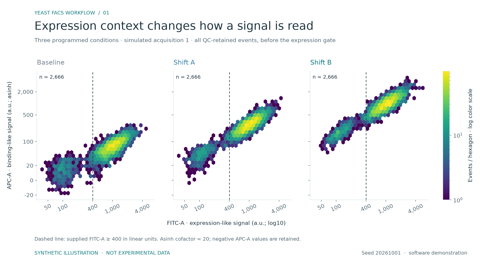
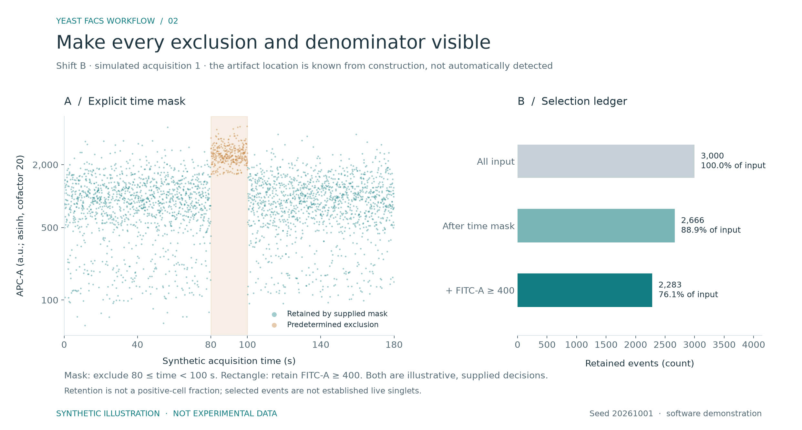
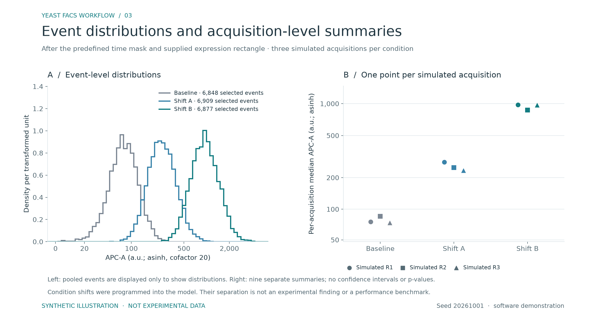
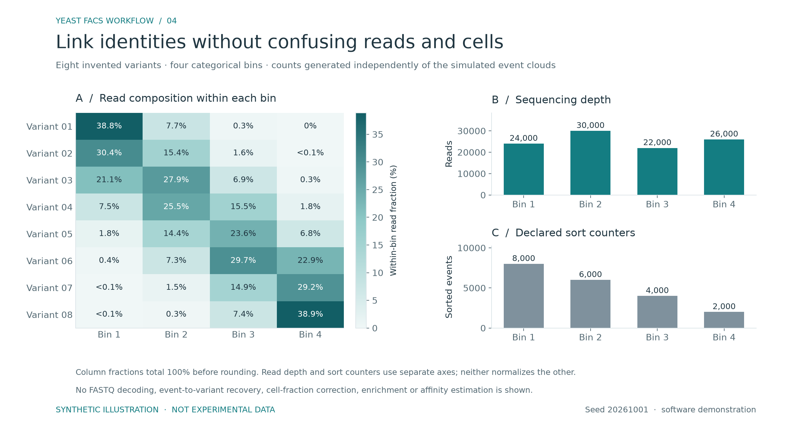

> Imported from yeast-facs-workflow at `19e3aa5`. For current installation and integration, start with the [Aureka Flow workflow guide](README.md). Historical software versions and validation results below describe the original repository.

# Synthetic workflow gallery

Four views of one explicitly artificial example: event measurements, acquisition-time QC, sample-level comparison and decoded-count linkage. These figures make the workflow inspectable; they are not a real-data benchmark or a demonstration of binding-affinity inference.

[Back to the project](legacy-overview.md) · [Input contracts](input-formats.md) · [Integration boundaries](integrations.md) · [Validation record](validation.md)

## Reproduce it

From the repository root, using **Python 3.12+** (required by the pinned NumPy 2.5.3 gallery dependency; the base workflow supports Python 3.11+):

```sh
python -m venv .venv
source .venv/bin/activate
python -m pip install -e '.[docs]'
python examples/workflows/gallery/build_gallery.py --output outputs/gallery
```

The `gallery` extra pins NumPy 2.5.3 and Matplotlib 3.11.2 for this demonstration. Open `outputs/gallery/index.html` after generation. Choose a new output directory; existing runs are not an overwrite target.

```text
outputs/gallery/
├── index.html                 gallery navigation
├── figures/                   four panels, each as PNG and SVG
├── summary.json               derived statistics, seed, parameters and software
├── gallery-manifest.json      hashes for the complete generated output tree
└── workflow/                  standard JSON/HTML workflow outputs and run receipt
```

Only the four PNG/SVG previews and [summary.json](gallery/summary.json) are checked into `docs/gallery/`. Raw event arrays and the full generated workflow are not committed. The complete hash manifest belongs to the regenerated output directory, not this smaller preview subset. These assets are synthetic examples, not private laboratory exports.

The seed fixes the simulated inputs. Byte-identical images are not promised across arbitrary plotting-library versions, font installations or operating systems. Use the generated summary and JSON measurements to inspect the numerical example rather than treating a rendered picture as a complete provenance record.

## What is simulated

| Item | Declared setting | Interpretation boundary |
| --- | --- | --- |
| Random seed | `20261001` | Reproducible synthetic example, not independent experimental evidence |
| Conditions | Baseline, Shift A, Shift B | Labels for simulated distributions, not biological treatments |
| Replicates | 3 simulated replicates per condition | Nine invented sample identities, not nine measured cultures |
| Events | 3,000 per sample; 27,000 total | Event count does not increase the number of replicate identities |
| Channel roles | Expression-like and binding-like fluorescence | Illustrative roles, not marker validation or established phenotype |
| Acquisition disturbance | Known injected transient at 80–100 seconds | Its location is supplied by the simulation, not detected by a QC algorithm |
| External event mask | Predetermined exclusion of that transient interval | Demonstrates explicit event selection; not PeacoQC, flowAI or flowCut execution |
| Fluorescence rectangle | Supplied FITC ≥ 400 | A fluorescence-value selection, not a live-cell, singlet or yeast gate |
| Decoded-count example | 8 artificial variants across 4 bins | Counts come from a separate synthetic model, not the event phenotype |

Neither the simulated channel relationship nor the artificial count model is evidence that this workflow recovers true affinity, biological populations or variant effects.

## 1 · Event landscape



[Vector SVG](gallery/01-event-landscape.svg)

The hexbin view shows where simulated events fall in expression-like/binding-like coordinates. The marked fluorescence cutoff is an **explicit input** to the example. The workflow does not discover it from the density plot or certify it against controls.

All simulated expression-like FITC values are positive, so the horizontal display uses log10. Binding-like APC values use `asinh(value / 20)`, which retains negative and zero values; ticks are labeled in the original arbitrary units. These are display transforms, not an automatic normalization or calibration. The supplied FITC ≥ 400 gate is evaluated in linear detector units, not transformed plot coordinates.

Use this panel to see the shape of the simulated measurements and the role of a supplied selection. Do not interpret a density cluster as live singlets, a marker-positive population, or a functionally validated binding class. “Binding-like” is the name of a simulated signal, not an affinity measurement.

## 2 · Acquisition QC and selection



[Vector SVG](gallery/02-qc-and-selection.svg)

The known 80–100-second disturbance is excluded using a predetermined mask. The plot illustrates the connection between acquisition time, retained original-event identities and downstream denominators. It does **not** show automated anomaly detection or validate the correctness of a real QC removal.

The stage counts have distinct meanings:

1. **Input events:** all events in each simulated acquisition.
2. **After external mask:** original events retained by the explicitly supplied mask.
3. **After fluorescence rectangle:** masked events also meeting the supplied FITC cutoff.

Detector medians use finite values among the selected events. Retention through these stages does not establish viable, single or expressing yeast, and a retention fraction is not an assay-specific positive-cell fraction.

For real files, the external-mask contract binds the mask to the source SHA-256, event count and zero-based original event indices. Attribution in that file says where the selection came from; it is not proof that this package executed or validated the named external method. See [input formats](input-formats.md).

## 3 · Replicate-aware exploratory comparison



[Vector SVG](gallery/03-replicate-comparison.svg)

Selected events are pooled within each condition only to display the left-hand distributions; their density is per transformed `asinh(APC / 20)` unit. The adjacent per-replicate medians retain the nine declared sample identities rather than treating 27,000 events as independent biological replicates. Negative signals are not removed merely to make a logarithmic display possible.

The illustrated shifts were put into the simulation. This panel performs no pooled-event significance test, fits no affinity model and supplies no biological confidence interval. Apparent separation in these figures is not a performance benchmark. The visual alignment of channels or medians does not qualify calibration, batch normalization or comparability across instruments.

The ordinary workflow report has a narrower scope than this gallery: it renders individual sample medians from the supplied `channels` summaries, with finite/selected denominators and full metadata tables. Those default SVG plots preserve negative values and mark zero only as a numerical reference. They show at most 50 sample rows per plot, explicitly label truncation and retain the complete table. They do not generate the event-density/distribution figures shown here for arbitrary real-data inputs.

## 4 · Sort-bin and decoded-count linkage



[Vector SVG](gallery/04-sortseq-linkage.svg)

The count example links eight artificial variants to four bins through explicit bin, FCS-sample and sequencing-sample identities. Read fractions divide each supplied variant count by the total supplied variant counts within that sequencing sample.

Sequencing-read depth and declared sorted-event counters are shown as different quantities. Neither is the denominator for the other, and they are not automatically reconciled or used to normalize one another.

Crucially, these counts are produced by an **independent synthetic model**. They are not generated from the event-level binding-like values and do not demonstrate phenotype-to-sequence recovery. The example validates an explicit software join, not a biological linkage claim.

No raw FASTQ decoding, barcode verification, sort-fraction correction, amplification correction, input-library enrichment or affinity fitting is performed. Missing count rows remain missing; an explicit zero is a supplied count, not proof of biological absence.

## How to use the example responsibly

- Trace sample IDs, original-event masks, selected counts and per-channel finite counts through the emitted JSON before interpreting a figure.
- Keep event-level views, replicate-level summaries and sequencing-read fractions separate. They answer different descriptive questions and use different denominators.
- Replace the synthetic manifest and processing decisions with independently reviewed, explicit inputs for real work. Do not transfer this example's time window or fluorescence threshold to a laboratory assay by default.
- Review control design, gate-coordinate conventions, compensation, calibration and biological replicate identities outside this alpha. Identically named detectors do not guarantee compatible measurements.
- Treat software tests and a reproducible simulation as software verification, not biological validation or a benchmark against upstream tools.

No third-party algorithm is copied into this gallery. NumPy and Matplotlib provide numerical generation and plotting; FlowKit is the separately implemented optional native FCS adapter. Other projects in the [upstream catalog](upstream-catalog.json) remain subject to their documented integration and license boundaries. Original gallery code and assets are covered by this repository's [MIT license](../../aureka_flow/workflows/LICENSE); upstream dependencies retain their own licenses.
