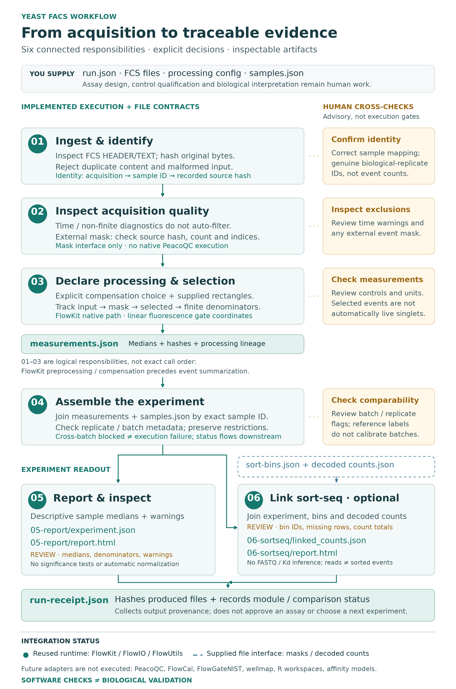
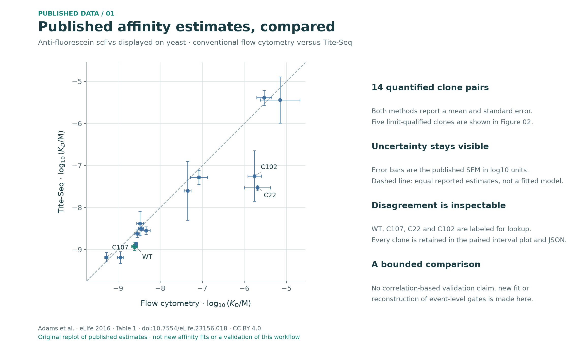
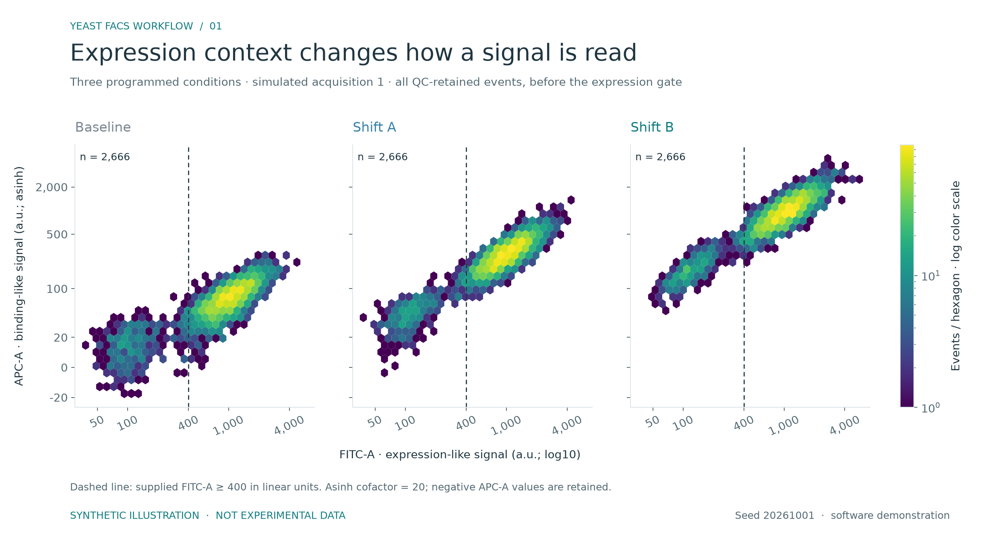
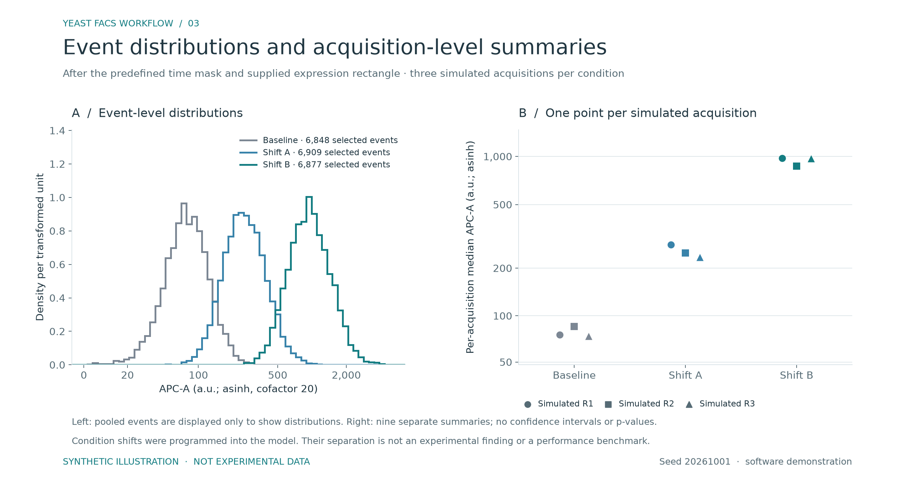

> Imported from yeast-facs-workflow at `19e3aa5`. For current installation and integration, start with the [Aureka Flow workflow guide](README.md). Historical software versions and validation results below describe the original repository.

# Yeast FACS Workflow

[](https://github.com/Drjackxiaoyuchen/yeast-facs-workflow/actions/workflows/tests.yml)
[](pyproject.toml)
[](LICENSE)

**An inspectable path from yeast FACS files to experiment reports and sort-seq linkage.**

This project connects six analysis responsibilities in **one local workflow**. It reuses FlowKit for native FCS processing and adds explicit sample identities, event-selection bookkeeping, experiment metadata, reports and decoded-count linkage. The aim is to make a result understandable from its source file through every processing decision—not just to produce another FACS plot.

**Software alpha—not a biologically validated pipeline.** Examples include seeded simulations and separately attributed published-data replots. The workflow does not infer live singlets, establish assay validity, fit affinity or call enriched variants.

[Why this exists](#why-this-exists) · [Workflow](#one-workflow-six-reviewable-stages) · [How it was built](#how-we-built-it) · [Cross-check a run](#cross-check-a-run) · [Published data](#learn-from-published-data) · [Pseudodata](#see-the-workflow-on-pseudodata) · [Run locally](#use-your-fcs-files-locally)

## Why this exists

A yeast-display or yeast-interaction experiment asks more than “which sample is brighter?” A useful interpretation also depends on **which acquisition was measured, which events remain, which controls support that selection, and what the independent experimental unit is**. If sequencing follows sorting, one more identity chain must survive: acquisition → sort bin → sequencing sample → variant counts.

The design focuses on three gaps between existing tools:

- **Processing decisions can disappear at handoffs.** A plot or exported median alone does not say whether compensation ran, whether a time interval was excluded, or which denominator produced the number. We retain these decisions with the sample summary.
- **Numerical units and experimental units can be confused.** Events, repeated acquisitions and biological replicates are different; acquired events, sorted-event counters and sequencing reads are also different. We keep those identities and denominators separate.
- **A successful script is not a successful assay.** Invalid identities should fail; unresolved QC or comparability issues should remain visible; biological judgments should stay with the researcher. Those are different outcomes, not a single green “passed” badge.

This is why the six sections are connected rather than published as unrelated tools. One installable repository gives them a shared file contract, one run entry point and tests across the handoffs. It does **not** replace established cytometry methods or make every reviewed upstream package an installed dependency.

## One workflow, six reviewable stages



[Open the vector diagram](figures/workflow-overview.svg) · [Step-by-step cross-check guide](workflow-review.md) · [Input schemas and examples](input-formats.md)

The diagram is editable and reproducible from [its renderer](../../scripts/render_workflow_diagram.py): after installing `.[gallery]`, run `python scripts/render_workflow_diagram.py --output-dir outputs/workflow-diagram`.

The numbering describes **logical responsibilities and review checkpoints**, not six independent programs or six intermediate folders. In the native path, FlowKit preprocessing and optional compensation happen before event summarization; Time diagnostics still describe the original acquisition. Stage 4 feeds both the experiment report and the optional sort-seq branch. Manual review notes in the diagram are **not implemented approval gates**.

| Stage | Rationale and implementation | What you should cross-check |
| --- | --- | --- |
| **1 · Identify the acquisition** | Start with an unambiguous source. Our bounded HEADER/TEXT inspector and SHA-256 checks accompany optional native decoding through [FlowKit](https://github.com/whitews/FlowKit) and its FlowIO/FlowUtils stack. | Correct file, detector names and `sample_id`; declared versus decoded event count. A file hash proves identity, not sample biology. |
| **2 · Review acquisition quality** | Acquisition artifacts must be distinguished from biological populations. Original Time/non-finite diagnostics flag issues; a hash-bound external mask can select original events. [PeacoQC](https://github.com/saeyslab/PeacoQC) is a candidate external tool, **not an executed adapter**. | Time flags, mask source/hash and retained counts. Diagnostics do not automatically remove events; a valid mask is not proof that its exclusions are scientifically appropriate. |
| **3 · Make selection explicit** | Fluorescence depends on preprocessing and compensation. FlowKit applies an explicitly requested embedded matrix; our code intersects supplied fluorescence rectangles and records selected indices and finite denominators. | Compensation state, gate coordinates, controls and each channel's denominator. [FlowCal](https://github.com/taborlab/FlowCal) and [FlowGateNIST](https://github.com/djross22/flowgatenist) remain candidate extensions—not hidden yeast/singlet gates. |
| **4 · Reconstruct the experiment** | Join measurements to declared condition, biological-replicate and batch identities. Original checks expose missing metadata, repeated acquisitions and comparison restrictions. [wellmap](https://github.com/kalekundert/wellmap) is a possible future layout importer. | Exact sample join, true replicate identities, batch confounding and processing differences. Matching labels do not establish calibration or comparable populations. |
| **5 · Make evidence inspectable** | Original HTML/SVG reports show per-sample medians, denominators, metadata and warnings together. JSON preserves the underlying summaries; the run receipt hashes produced files. | Trace a displayed median to its JSON record and finite count. Inspect warnings before interpreting a plot; review output labels before sharing. |
| **6 · Link sorting to sequencing, optionally** | An original bridge joins explicit sort-bin and sequencing-sample IDs to supplied decoded variant counts. It keeps read fractions separate from sorted-event counters. [dms_variants](https://github.com/jbloomlab/dms_variants) and [Tite-Seq analysis](https://github.com/jbkinney/16_titeseq) are downstream references, **not integrated inference engines**. | Unique bin/sample mappings, missing versus zero counts, and the read-fraction denominator. Neither linkage nor fluorescence estimates affinity. |

## How we built it

1. **Review the upstream landscape.** The [34-repository source catalog](upstream-catalog.json) records reviewed commits, workflow roles and license caveats. It is a source-review record, not a 34-tool compatibility benchmark.
2. **Reuse the native foundation.** The optional runtime calls **FlowKit 1.3.2** for FCS decoding/preprocessing and embedded compensation. No upstream implementation is copied or relicensed. Its FlowIO/FlowUtils dependencies retain their own licenses.
3. **Build the connections explicitly.** Three original component packages—[`aureka_flow.workflows.core`](../../aureka_flow/workflows/core), [`aureka_flow.workflows.workbench`](../../aureka_flow/workflows/workbench) and [`aureka_flow.workflows.sortseq`](../../aureka_flow/workflows/sortseq)—are composed by one [orchestrator](../../aureka_flow/workflows/pipeline.py). Versioned JSON carries identities, processing choices, denominators and restrictions between them.
4. **Test the failure paths as well as the demo.** Generated FCS fixtures exercise the native path; invented arrays exercise reporting and linkage. Tests reject mismatched source hashes, ambiguous joins, duplicate acquisitions and overwritten outputs. Seeded figures expose the numerical bookkeeping. These tests establish software behavior, **not real-data or biological validity**.
5. **Add published evidence with traceable limits.** We replot the Tite-Seq paper's 19-clone comparison table and process two authentic bacterial FCS acquisitions from FlowGateNIST's SI. Each example retains its source, data license, uncertainty or processing choices and reproducible script. They test different things; neither is relabeled as a yeast biological benchmark.

The contribution is the **traceable integration layer**, not a claim to invent FCS decoding, automated cytometry QC or Tite-Seq inference. The external-mask interface is a deliberate boundary: it accepts an event selection produced and reviewed elsewhere, without pretending to run the method named in its metadata. See [upstream choices, alternatives and licensing](integrations.md) for the rationale at each stage.

## Cross-check a run

Start with `index.html`, but treat the JSON as the inspectable record. The [review guide](workflow-review.md) maps every stage to exact fields, source functions and tests, including a worked synthetic acquisition.

| Result to inspect | Where it lives | Question to answer |
| --- | --- | --- |
| Source, selection and channel denominators | `measurements.json` | Which exact acquisition and original events produced this median? |
| Declared experimental identities | `samples.json` | Are condition, biological replicate and batch assignments correct? |
| Joined evidence and restrictions | `05-report/experiment.json` and `report.html` | Is this only exploratory, metadata-limited or cross-batch restricted—and why? |
| Optional count linkage | `06-sortseq/linked_counts.json` and `report.html` | Which bin and sequencing sample supply each variant count? |
| Produced-file integrity | `run-receipt.json` | Do the output hashes still match? This does not sign off on scientific validity. |

**Read statuses literally.** Malformed configurations, source/mask mismatches and invalid identity joins reject the run. QC flags and missing replicate metadata generally generate warnings. `cross_batch_blocked` restricts biological interpretation; it does **not** stop report or sort-seq generation. Even `exploratory_only` is not approval. Control qualification and biological interpretation remain manual responsibilities.

## Learn from published data

Author-linked repositories are valuable because their code and data accompany a defined experiment. Two useful examples are [Adams et al.'s Tite-Seq study](https://elifesciences.org/articles/23156) and [author repository](https://github.com/jbkinney/16_titeseq), and [Ross's FlowGateNIST study](https://doi.org/10.1371/journal.pone.0250753) and [author repository](https://github.com/djross22/flowgatenist). We use explicitly licensed publisher-hosted data, with original plotting code—not copied paper figures or an implied implementation of every author method.



*Real published yeast-display results: 14 quantified clone pairs from Adams et al., Table 1. Error bars preserve published SEM in log10(KD/M). All 19 clones, including five with approximate limits, remain in the companion interval plot and data file. These are author-fitted estimates, not new affinity fits.* [SVG](papers/01-published-method-comparison.svg)

The [three-figure paper-data gallery](paper-data-gallery.md) adds the all-clone comparison and a raw-FCS acquisition view: **13,899 events from a buffer blank and 65,689 events from an E. coli acquisition**, all retained. The latter exercises authentic file decoding and summary generation, **not yeast gating or FlowGateNIST's algorithm**. Each figure links to source values, hashes, reproduction commands and the [CC-BY attribution record](papers/ATTRIBUTION.md). No private laboratory data are included.

## See the workflow on pseudodata

The gallery uses **27,000 seeded synthetic events**: three illustrative conditions × three simulated replicates × 3,000 events. It demonstrates data flow and interpretation boundaries, not performance on a laboratory dataset.



*Event-level view of the simulation. “Expression” and “binding” are illustrative channel roles, not established phenotypes. Positive FITC values use a log10 display; APC uses asinh(value / 20), retaining negative values. The supplied FITC ≥ 400 rectangle is evaluated in linear units, not display coordinates; it is not a yeast, live-cell or singlet gate.* [SVG](gallery/01-event-landscape.svg)



*Keep the unit of comparison visible: selected-event distributions alongside individual simulated-replicate medians. No pooled-event significance tests, confidence intervals or biological effect claims.* [SVG](gallery/03-replicate-comparison.svg)

The [four-panel gallery and reproducible recipe](demo-gallery.md) also show acquisition-time QC, selection denominators and the distinction between sequencing-read fractions and declared sorted-event counters.

### Reproduce the gallery

Use **Python 3.12 or newer** for this optional gallery; the lightweight base workflow still supports Python 3.11+.

```sh
git clone https://github.com/Drjackxiaoyuchen/yeast-facs-workflow.git
cd yeast-facs-workflow
python -m venv .venv
source .venv/bin/activate
python -m pip install -e '.[docs]'
python examples/workflows/gallery/build_gallery.py --output outputs/gallery
```

The optional `gallery` extra pins NumPy 2.5.3 (requires Python 3.12+) and Matplotlib 3.11.2. Open `outputs/gallery/index.html` after generation. Seed `20261001`, the numerical summary, software provenance, output hashes and connected workflow outputs are retained in the generated directory. The images above and the [checked-in summary](gallery/summary.json) are synthetic examples, not real-data results.

**Gallery figures are not a new real-data analysis algorithm.** Event-density plots and selected-event distributions are generated from this seeded demonstration. The default analysis report provides per-sample detector-median SVG plots and complete denominator/metadata tables; it does not automatically generate event-density gates or infer comparable instrument units.

## Lightweight demo—no plotting dependencies

Python 3.11+; no flow-cytometry dependency is needed for this small demo.

```sh
python -m pip install -e .
aureka-flow-workflow demo --output outputs/demo
```

Open `outputs/demo/index.html` in a browser. The demo has three invented acquisition records and artificial variant counts. Its missing biological-replicate identities intentionally produce `metadata_limited`, not a misleading success verdict. Use a new output directory for each run; the workflow never overwrites one.

```text
outputs/demo/
├── index.html                    six-module navigation
├── measurements.json            event summaries and processing provenance
├── samples.json                 explicit sample metadata
├── 05-report/
│   ├── experiment.json          joined records and comparison restrictions
│   └── report.html              marker summaries and warnings
├── 06-sortseq/
│   ├── linked_counts.json       traceable decoded-count linkage
│   ├── report.html              within-sample read-composition table
│   └── synthetic_*.json         artificial sort/count inputs
└── run-receipt.json              output hashes and module status
```

This small built-in demo is separate from the 27,000-event gallery. Both use artificial arrays, not native FCS decoding. Optional native integration tests generate FCS files from scratch and exercise the decoder, compensation and external-mask path separately.

## Use your FCS files locally

Install the tested optional adapter:

```sh
python -m pip install '.[flow]'
mkdir -p outputs
aureka-flow-workflow core inspect /path/to/sample.fcs --output outputs/inspection.json
```

The `flow` extra pins **FlowKit 1.3.2**. Its transitive dependencies retain their own version constraints and licenses; this is not a fully locked environment. Record and qualify your environment before using scientific results.

Prepare a processing configuration for every file, an explicit sample manifest and a batch run manifest. See [input formats](input-formats.md) for complete examples and coordinate conventions. Then:

```sh
aureka-flow-workflow run --manifest /path/to/run.json --output outputs/my-run
```

Relative input paths resolve against `run.json`, not your current working directory. Duplicate FCS paths or identical FCS content are rejected to reduce accidental double-counting. Intentional reprocessing of one acquisition under different gates belongs in separate runs, not separate biological samples.

The sort-seq stage is optional for real runs. Supply both a sort-bin map and decoded counts, or neither. Commands remain available independently:

```sh
aureka-flow-workflow modules
aureka-flow-workflow core --help
aureka-flow-workflow workbench --help
aureka-flow-workflow sortseq --help
```

## Scientific and privacy limits

- FCS events and repeated acquisitions are not independent biological replicates. Replicate identities and control labels remain user declarations.
- Acquisition QC and fluorescence gates do not establish live, single, expressing yeast. Supply and review assay-specific controls outside this alpha.
- Gates use linear detector values after FlowKit preprocessing and the selected compensation, not logicle display coordinates. Negative values are preserved.
- Missing counts are not filled with zero. Read fractions are conditional on the supplied variant counts, without corrections for sort fractions, amplification, sequencing depth or phenotype.
- Results can retain filenames, sample labels, acquisition metadata and detector settings. **Local outputs are not automatically anonymized.** Review them before sharing.
- The analysis commands are local and do not upload data. Dependency installation, cloning and GitHub operations require network access. Raw-data patterns are ignored by Git as a guardrail, not a privacy guarantee.

## Development and validation

```sh
python -m pip install -e .
python -m unittest discover -s tests -v
# Include native FCS integration tests:
python -m pip install -e '.[flow]'
python -m unittest discover -s tests -v
```

Tests cover input validation, non-finite values, negative fluorescence, compensation, event masks, denominators, joins, missing counts, report escaping, fresh-output behavior and full workflow connections. Published-data tests also check table extraction, bounds, attribution, archive integrity and offline figure generation. Optional tests skip explicitly when their dependencies are absent. CI runs the standard-library workflow on Python 3.11–3.13, the optional native integration on Python 3.12, and a gallery job that regenerates synthetic figures, the diagram and published-table figures. CI does not download the supplementary FCS archive; that native example is a separate explicit local check.

See the [validation record](validation.md) and [architecture and extension contracts](architecture.md). Contributions should include synthetic tests and clearly separate source review, software verification and biological validation.

The live test badge reports hosted CI; the versioned validation record describes specific local checks. Neither establishes real-data accuracy or biological validity.

## License

Original code: [MIT](../../aureka_flow/workflows/LICENSE). The curated published table and dataset-derived figures/receipts have separate **CC BY 4.0** terms and [source attribution](papers/ATTRIBUTION.md). Upstream tools retain their respective licenses and authorship. This project is not endorsed by their maintainers. The catalog is a source-review record, not a legal opinion or complete transitive license audit.
