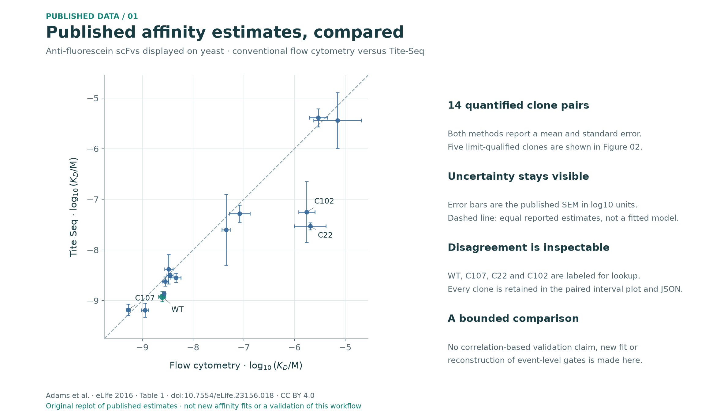
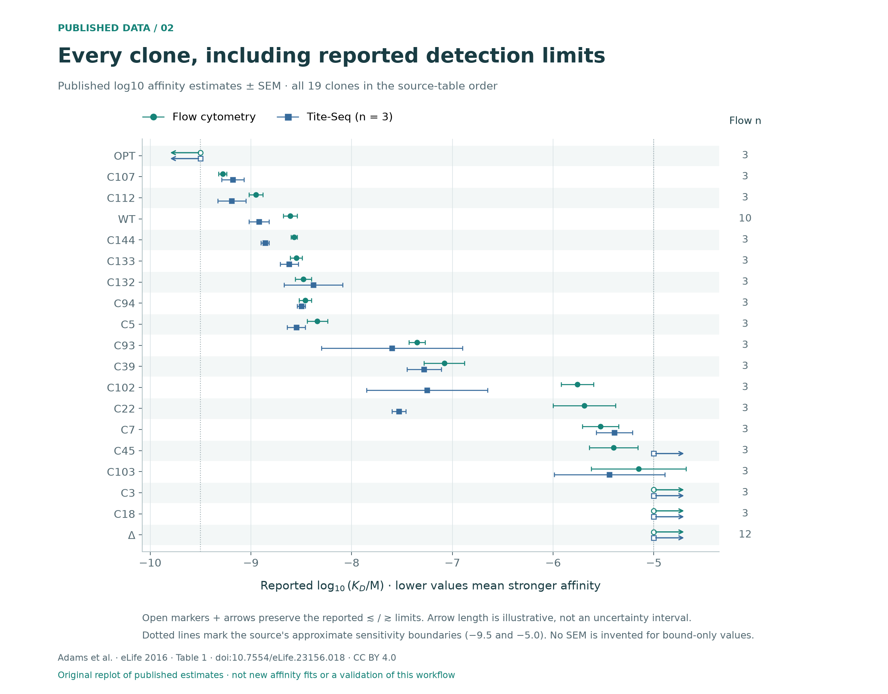
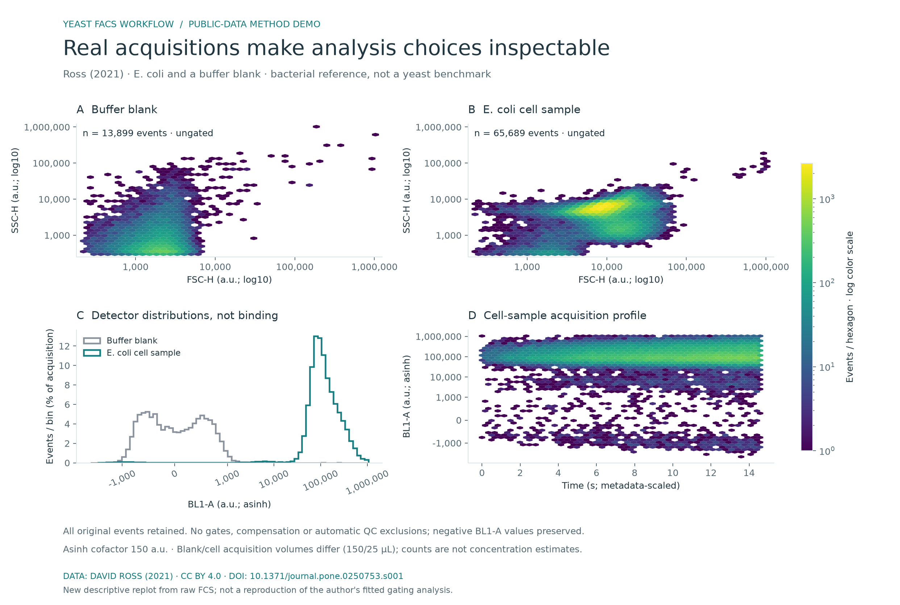

> Imported from yeast-facs-workflow at `19e3aa5`. For current installation and integration, start with the [Aureka Flow workflow guide](README.md). Historical software versions and validation results below describe the original repository.

# From published evidence to inspectable examples

These figures complement the [synthetic gallery](demo-gallery.md) with **real published measurements**. They answer different questions: can we preserve a paper's uncertainty and limits, and can the native FCS path process two authentic supplementary acquisitions? They are not a biological validation of this yeast workflow.

| Evidence level | Input and operation | What you can cross-check |
| --- | --- | --- |
| Synthetic workflow demonstration | Seeded events and invented decoded counts pass through the connected modules. | Identities, selections, denominators and reporting contracts. |
| Published yeast-display summaries | Replot all 19 entries from Adams et al., Table 1; no new fitting. | Published estimates, log-space SEM, replicate counts and approximate bounds. |
| Published raw FCS | Decode and summarize a buffer blank and an E. coli acquisition from Ross's supplementary dataset. | Real-file parsing, metadata scaling, retained events and plotted detector values. This is bacterial data, not a yeast benchmark. |

## 1. Tite-Seq: compare methods without hiding uncertainty

**Adams RM, Mora T, Walczak AM, Kinney JB (2016).** *Measuring the sequence-affinity landscape of antibodies with massively parallel titration curves.* eLife 5:e23156. [Paper](https://elifesciences.org/articles/23156) · [Table 1 DOI](https://doi.org/10.7554/eLife.23156.018) · [Author repository](https://github.com/jbkinney/16_titeseq).

This is directly relevant to yeast display: the study measured anti-fluorescein scFvs using concentration-dependent titration curves, and compared Tite-Seq estimates with conventional flow-cytometry titrations. We selected its publisher-hosted table as a compact, auditable starting point—not the authors' entire analysis pipeline.



[Editable SVG](papers/01-published-method-comparison.svg)

The identity line is **not a fitted regression**. Error bars are the authors' standard errors in log10(KD/M), not linear-molar errors, standard deviations or confidence intervals. C22 and C102 remain visible even though their method estimates differ substantially; no correlation-based accuracy claim is made.

Five clones have a reported approximate limit in at least one method, so they cannot be represented as ordinary point estimates in that scatterplot. They are **not discarded from the dataset**:



[Editable SVG](papers/02-published-clone-intervals.svg) · [19-row data with original affinity expressions](../../examples/workflows/papers/data/adams-2016-table1.json) · [Provenance and output hashes](papers/adams-summary.json)

### What to inspect

- All 19 source rows remain in the original order; 14 have quantified estimates for both methods. OPT, C45, C3, C18 and Δ retain approximate bounds. Open markers and arrows express direction only; arrow length is not an uncertainty interval.
- Table 1 reports three replicate Tite-Seq experiments for every clone. Flow replicate counts are 3 except WT (10) and Δ (12). These counts are measurements as reported, not inferred biological-replicate identities.
- WT is **−8.61 ± 0.07** by flow and **−8.92 ± 0.10** by Tite-Seq, in log10(KD/M). This is the Table 1 aggregation, not a substituted estimate from another figure or synonymous-variant average.
- No FCS gates, sequencing counts or individual titration curves were reconstructed. The KDs are **published author-fitted estimates**; this workflow still does not fit affinity.

### Why this matters for the six-stage workflow

Stages 1–4 should preserve sample, concentration, control and replicate identities so a later inference method has meaningful inputs. Stage 5 should show uncertainty and measurement limits instead of silently turning bounds into points. Stage 6 only links supplied bin/count identities today; reproducing the authors' Tite-Seq inference would be a separate, qualified implementation. This example illustrates that distinction rather than claiming the linkage already estimates KD.

### Reproduce the two figures offline

From the repository root, use Python 3.12+ and a new output directory:

```sh
python -m pip install -e '.[docs]'
python examples/workflows/papers/build_paper_gallery.py --output outputs/paper-gallery
python -m unittest discover -s tests -p 'test_paper_*.py' -v
```

The committed JSON is enough; rendering makes no network requests. The original [extractor](../../examples/workflows/papers/extract_adams_table.py) can independently rebuild the small table from an explicitly downloaded publisher response:

```sh
mkdir -p outputs/publisher-source
curl -fL https://api.elifesciences.org/articles/23156 -o outputs/publisher-source/elife-23156.json
python examples/workflows/papers/extract_adams_table.py --input outputs/publisher-source/elife-23156.json --output outputs/publisher-source/re-extracted-table1.json
```

The source snapshot was retrieved on **2026-10-01**. Its SHA-256 is `f9d439ef1b0bbc9134baa3612a19127b3982ad3af104a9b6a3864bac5c064c97`; the extracted Table 1 HTML hash is `ac6680e598ae101348333be216182a2afaf8f1e6a4731f41d94f8efeb93cc254`. Both are recorded in the JSON. A future publisher response may change; inspect the table and provenance before accepting a new snapshot. Use a fresh directory when downloading to avoid replacing earlier source files.

## 2. Raw FCS from a paper's supplementary information

**Ross D (2021).** *Automated analysis of bacterial flow cytometry data with FlowGateNIST.* PLOS ONE 16:e0250753. [Paper](https://doi.org/10.1371/journal.pone.0250753) · [Supplementary dataset](https://doi.org/10.1371/journal.pone.0250753.s001) · [Author repository](https://github.com/djross22/flowgatenist).

The paper's SI provides a small, explicitly licensed raw-data test. `Fig 2A.fcs` is the buffer blank (**13,899 events**); `Fig 2BCD.fcs` is the E. coli sample (**65,689 events**). The paper's Figure 2 caption establishes those roles and the SI ReadMe maps the filenames. These two acquisitions are not biological replicates.



[Editable SVG](papers/03-public-fcs-qc.svg) · [Machine-readable measurements, provenance and hashes](papers/flowgatenist-summary.json) · [Original demo script](../../examples/workflows/papers/build_fcs_si_demo.py)

### What was executed—and what was not

Both files passed this project's HEADER/TEXT inspection and native `analyze_fcs` path with FlowKit 1.3.2. Decoded event counts and channel medians were checked against the arrays used to draw the figures. **All 79,588 events were retained.** No cell/singlet gates, QC masks or fluorescence compensation were applied; the presence of an embedded spillover matrix is recorded, but it was not applied. The core schema calls measured inputs `user_data`; the enclosing receipt explicitly identifies these as public experimental data, not private data or a simulation.

FlowKit preprocessing applies amplification/gain and metadata-defined Time scaling. Its `raw` event source means **uncompensated**, not byte-identical stored detector values. Scatter uses positive FSC-H/SSC-H on log10 axes; BL1-A uses asinh(value / 150), preserving negative values. Histograms use common transformed bins and percentages within each acquisition. Blank and cell acquisition volumes differ (150 versus 25 µL), so raw counts are not comparable concentration estimates. The time view is descriptive, not an automated QC verdict.

**This does not run FlowGateNIST's Gaussian-mixture gating or calibration.** It is our descriptive replot of the authors' raw SI, not a reproduction of their analysis or a demonstration of yeast gate accuracy. Its value for stages 1–3 and 5 is authentic input compatibility and visible processing choices.

The SI also exposed an inspector compatibility issue: these files declare a TEXT region with ASCII-space padding after its closing delimiter. The bounded fix accepts that padding while retaining rejection of malformed tails, duplicate keys and invalid delimiters. Regression tests do not establish universal FCS-format support.

### Reproduce from an explicit download

Raw FCS and the publisher archive are **not bundled in this repository**. Download the public SI into a fresh local directory, then provide that archive explicitly:

```sh
python -m pip install -e '.[flow,gallery]'
mkdir -p outputs/ross-source
curl -fL https://ndownloader.figshare.com/files/29190015 -o outputs/ross-source/pone.0250753.s001.zip
python examples/workflows/papers/build_fcs_si_demo.py --source-zip outputs/ross-source/pone.0250753.s001.zip --output outputs/ross-demo
```

The script verifies the **22,764,704-byte** archive, publisher MD5 `0faf828873bb46c8809e09956a6069c6`, pinned SHA-256 `349feafb438e2b47675ad461fb781b34e7d3b423abe700f55e23c8bc94aa6cf3`, and each selected FCS member's hash. It reads only the two named members into a temporary directory; it does not extract the whole archive, load pickles, run author code or fetch files itself. Outputs refuse existing directories. If the core rejects these hash-verified files in a future environment, the receipt explicitly distinguishes fallback FlowKit plotting from successful core execution. Changed archives are rejected before that fallback.

## Reuse and attribution are part of reproducibility

See the [per-asset attribution and license record](papers/ATTRIBUTION.md). Original project code remains MIT; the published table and these dataset-derived figure/summary files are distributed under **CC BY 4.0**, not silently relicensed as MIT.

The Tite-Seq authors' GitHub repository has no explicit license in the reviewed snapshot. We therefore used the publisher's CC-BY table, without copying the repository's code or data. Ross's article is CC0, but its **dataset deposit says CC BY 4.0**; this example follows the dataset-specific license. [FlowCal](https://github.com/taborlab/FlowCal) is also a useful author-linked project, but its [publisher SI deposit](https://doi.org/10.1021/acssynbio.5b00284.s002) is CC BY-NC 4.0; it was not selected for this unrestricted public example. Source availability and a code license do not automatically establish reuse rights for every associated dataset.

No private laboratory measurements, sequences or lab notes were used in these figures. No original paper figure was copied: the layouts and plotting code here are new.
